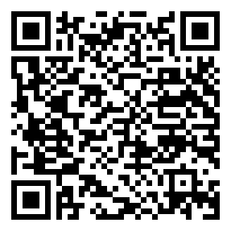

# Celeste 64 for Nintendo 3DS (unofficial fan port)

**3DS port by alexroses47.** A rewrite in C++ (libctru + citro3d) of
[Celeste 64: Fragments of the Mountain](https://github.com/EXOK/Celeste64) that runs on an
**Old 3DS with stereoscopic 3D**.

> This is an unofficial, non-commercial fan port. It is **not made or endorsed by the Celeste team**.
> The Celeste IP and the game content are owned by Maddy Makes Games, Inc.

## Install (FBI)

Open **FBI → Remote Install → Scan QR Code** and scan:



Or download `celeste64.cia` from the [latest release](../../releases/latest) and install it with FBI.

## What's included

- The whole game: title screen, postcard map, level 1, the 10 cassette levels (1-1 … 1-10) and the ending area.
- Strawberries, springs, crystals, feathers, falling/moving/traffic/cassette blocks, coins and gates,
  Granny, Theo, Badeline and the sign posts with their dialog and voices.
- Music and sound effects, pause menu with options, and save data (`sdmc:/3ds/celeste64/save.txt`).
- Stereoscopic 3D (slider), and a **30 FPS** option in *Pause → Options* for steadier frame pacing.

Known: level 1-8 (more than 12,000 spikes) can dip below 30 fps with 3D on when the camera
faces the spike walls.

## Controls

| Button | Action |
|---|---|
| Circle Pad | move |
| B / X | jump |
| A / Y | dash |
| L / R | climb |
| D-pad | camera |
| START | pause |

## Building

Requirements: devkitPro with `3ds-dev` and `3ds-libvorbisidec`, Python 3 with Pillow and numpy,
`vgmstream-cli` and `oggenc` (audio). For the `.cia`: `makerom` (Project_CTR) and `bannertool`
in `ext/ctrtools/` (see `build.sh`).

The game content is **not** in this repository: the converter reads it from your own copy.

```sh
git clone --depth 1 https://github.com/EXOK/Celeste64 ext/Celeste64
python3 -m venv tools/.venv && tools/.venv/bin/pip install pillow numpy
./build.sh convert     # converts maps, models, textures and audio into romfs/, builds celeste64.3dsx
./build.sh cia         # also builds celeste64.cia
```

## License

The code in this repository follows the MIT license of the original Celeste 64 source (see `LICENSE`).
Game content (and the icon/banner in `meta/`, made from it) belongs to Maddy Makes Games, Inc. and is
used under their permission for non-commercial fan projects.

---

## Español

**Port de 3DS por alexroses47.** Port no oficial y sin fines de lucro de Celeste 64 para la
**Old 3DS con 3D estereoscópico**. No está hecho ni respaldado por el equipo de Celeste.

Para instalarlo: **FBI → Remote Install → Scan QR Code** y escanea el código de arriba.
