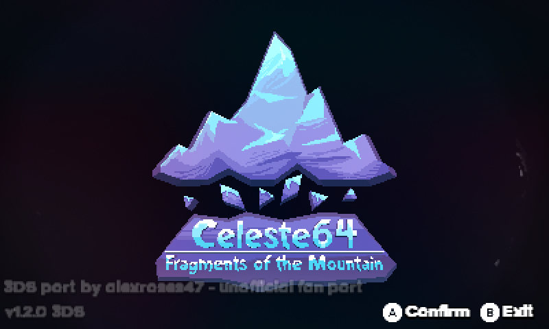
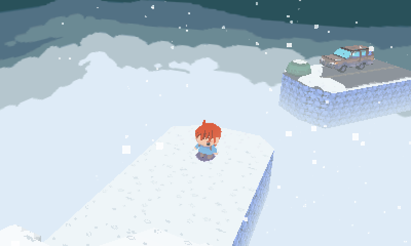
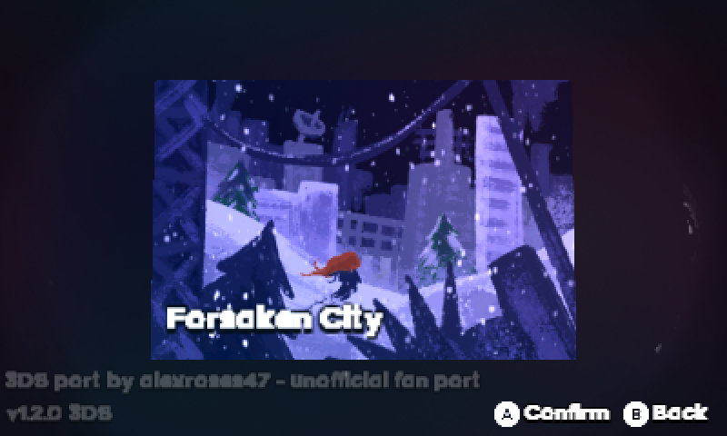
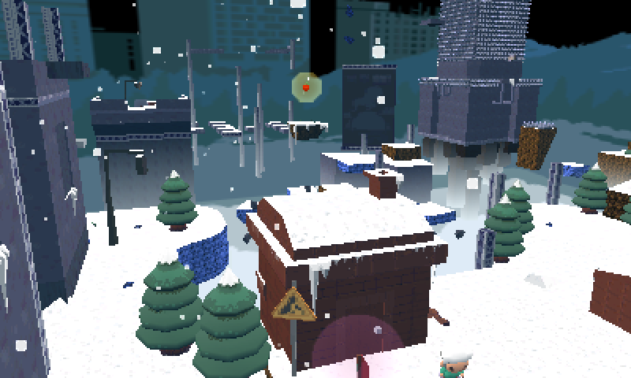
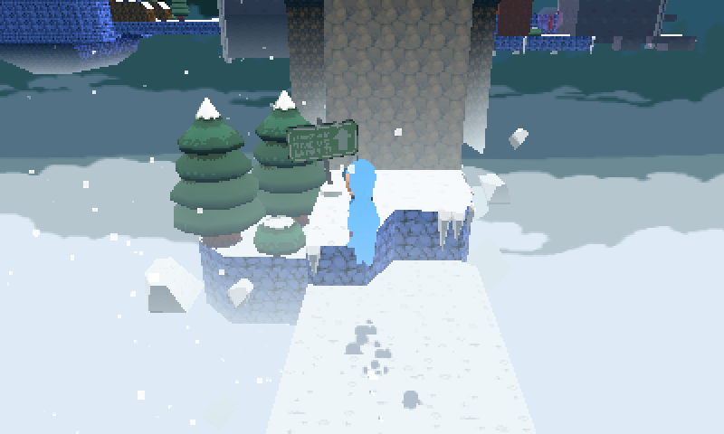
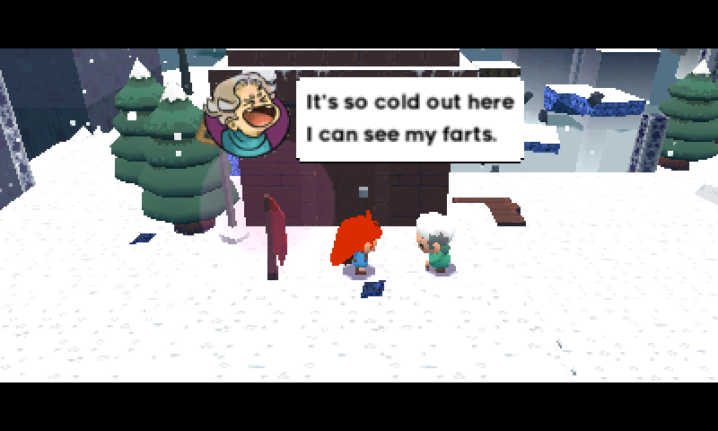
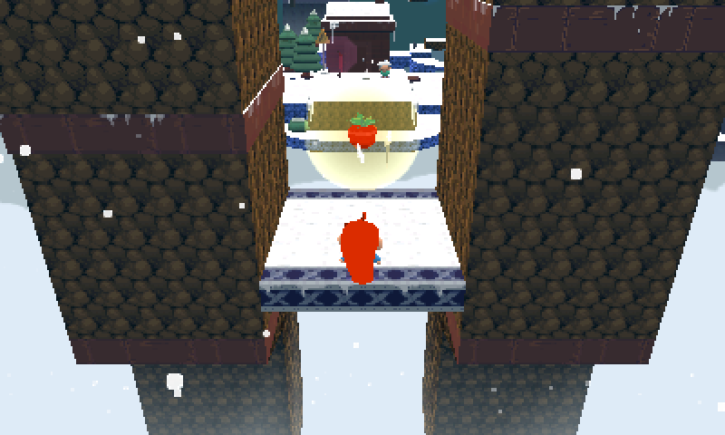
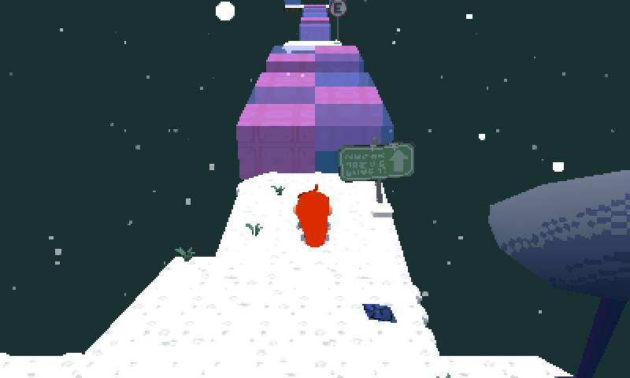
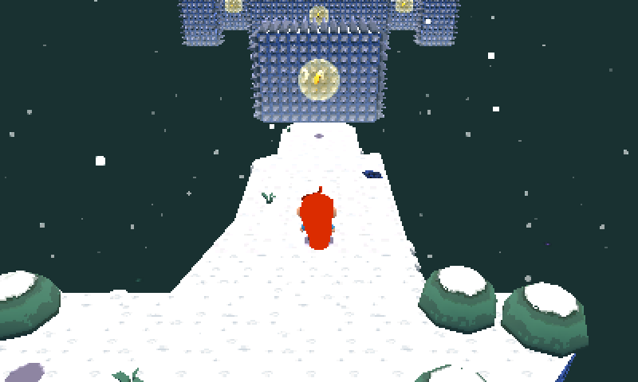
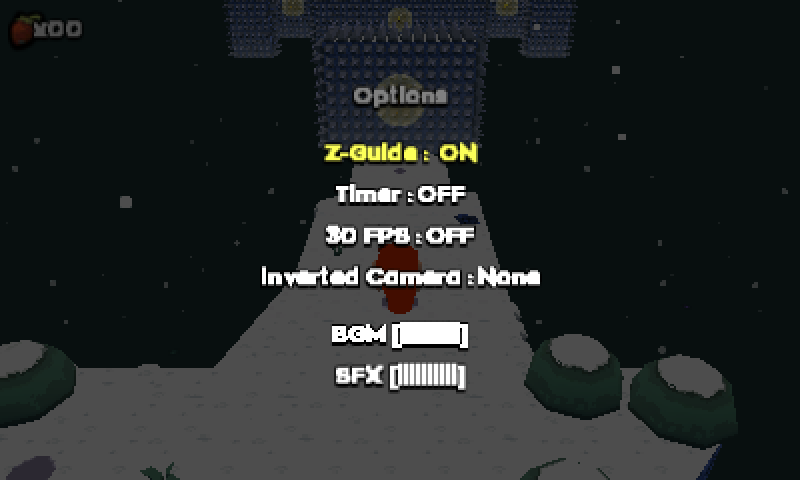

# Celeste 64 for Nintendo 3DS (unofficial fan port)

**3DS port by alexroses47.** A rewrite in C++ (libctru + citro3d) of
[Celeste 64: Fragments of the Mountain](https://github.com/EXOK/Celeste64) that runs on the
**original (Old) 3DS with stereoscopic 3D**.

> This is an unofficial, non-commercial fan port. It is **not made or endorsed by the Celeste team**.
> The Celeste IP and the game content are owned by Maddy Makes Games, Inc.

<p align="center">
   
</p>

## Install (FBI)

Open **FBI → Remote Install → Scan QR Code** and scan:


Or download `celeste64.cia` from the [latest release](../../releases/latest), copy it to your SD card
and install it with FBI.

## Features

- **Runs on Old 3DS** (and New 3DS). Tested on real Old 3DS hardware.
- **Stereoscopic 3D**: use the 3D slider; the whole game is rendered for both eyes.
- **30 FPS mode** (*Pause → Options → 30 FPS*): locks the game to a steady 30 fps. On Old 3DS the game
  runs between 30 and 60 fps depending on the scene; the lock gives even frame pacing, which feels smoother
  than a framerate that jumps around. The game logic always runs at a fixed 60 Hz like the original,
  so physics feel the same in both modes.
- **The whole game**: title screen, postcard level select, Forsaken City (level 1), the **10 cassette levels**
  (1-1 … 1-10) and the ending area.
- Madeline's full moveset: jump, dash, double dash, climbing, skidding, wall jumps, feathers, bubbles.
- Strawberries (and the strawberry bubbles), springs, refill crystals, feathers, checkpoint flags,
  falling / floating / moving / traffic / break / cassette blocks, coins and gates, the intro car.
- Granny, Theo, Badeline and the signs, with portraits, dialog and voices.
- Original music and sound effects, snow, dust, hair, dash trails, Madeline's silhouette behind walls,
  the Z-guide (drop shadow line), screen wipes.
- Pause menu with options (Z-guide, speedrun timer, 30 FPS, inverted camera, music and SFX volume)
  and save data in `sdmc:/3ds/celeste64/save.txt`.
- **3D HOME Menu banner**: the game's 3D logo, gently swaying, when you select the app.
- **Bottom screen**: Forsaken City postcard art with your strawberries, deaths and time while playing.

### Performance (measured on a real Old 3DS)

| Area | 3D on | 3D off |
|---|---|---|
| Level 1 | ~41 fps average | ~54 fps average |
| Level 1-8 (more than 12,000 spikes) | ~37 fps average, short dips when facing the spike walls | |

## Screenshots

*Taken from the emulator (one eye of the 3D image, 2× scaled).*

<p align="center">
   
   
   
   
</p>

## Controls

| Button | Action |
|---|---|
| Circle Pad | move |
| B / X | jump |
| A / Y | dash, talk |
| L / R | climb |
| D-pad | camera |
| START | pause |

## Building

Requirements: devkitPro with `3ds-dev` and `3ds-libvorbisidec`, Python 3 with Pillow and numpy,
`vgmstream-cli` and `oggenc` (audio). For the `.cia`: `makerom` (Project_CTR), `bannertool` and
[pycgfx](https://github.com/skyfloogle/pycgfx) (3D banner, needs `gltflib`) in `ext/ctrtools/` (see `build.sh`).

The game content is **not** in this repository: the converter reads it from your own copy.

```sh
git clone --depth 1 https://github.com/EXOK/Celeste64 ext/Celeste64
python3 -m venv tools/.venv && tools/.venv/bin/pip install pillow numpy
./build.sh convert     # converts maps, models, textures and audio into romfs/, builds celeste64.3dsx
./build.sh cia         # also builds celeste64.cia
```

## License

The code in this repository follows the MIT license of the original Celeste 64 source (see `LICENSE`).
Game content (and the icon, banner and screenshots, made from it) belongs to Maddy Makes Games, Inc. and is
used under their permission for non-commercial fan projects.

---

## Español

**Port de 3DS por alexroses47.** Port no oficial y sin fines de lucro de Celeste 64 que funciona en la
**Old 3DS con 3D estereoscópico**. No está hecho ni respaldado por el equipo de Celeste.

- **Instalar:** FBI → Remote Install → Scan QR Code y escanea el código de arriba.
- **Funciona en Old 3DS** (probado en consola real) y en New 3DS.
- **3D estereoscópico** con el deslizador, y **banner 3D** con el logo del juego en el menú HOME.
- **Pantalla de abajo** con el arte de Forsaken City y tus fresas, muertes y tiempo.
- **Modo 30 FPS** (*Pausa → Options → 30 FPS*): fija el juego a 30 cuadros parejos. Se siente más fluido
  que una velocidad que salta entre 30 y 60. La lógica siempre corre a 60 Hz como el original.
- **El juego completo:** título, mapa de postales, el nivel 1, los 10 niveles extra de cassette y la zona final,
  con música, voces, diálogos y partida guardada.
